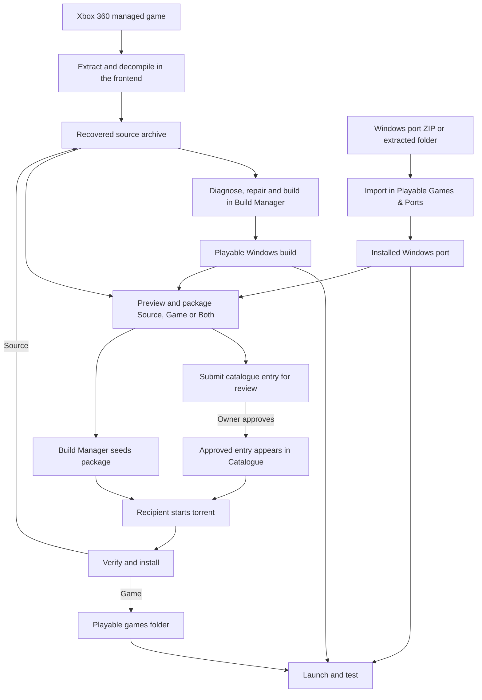

# Indie-Games-Core

Indie-Games-Core is a Windows workspace for recovering and rebuilding managed XNA and Xbox Live Indie Games (XBLIG), running Windows ports, and sharing source or playable packages through a community catalogue. It includes the C# **Indie Games Build Manager**, shared FNA and MonoGame projects, and repair and conversion tools.

[Get the packaged frontend on itch.io](https://pmortlock.itch.io/xenia-game-manager) · [Build Manager guide](IndieGames.BuildManager/README.md) · [Community catalogue](https://github.com/mortlockpaul-arch/Indie-Games-Catalogue)

## How the workflows fit together



The separately distributed Python frontend handles extraction and ILSpy decompilation and opens Build Manager. Both tools can use the same source archive. Recovered projects vary in compatibility and can require manual code or content fixes.

## Build Manager features

| Area | What you can do |
| --- | --- |
| Project discovery | Scan the source archive for C# projects and see their declared framework, platform, runtime, and build status. |
| Build and diagnostics | Restore, build, rebuild, and clean projects with captured output and cancellation. Inspect evaluated MSBuild properties, detect configuration issues, and use startup diagnostics to investigate launch failures. |
| Configuration | Set MSBuild platform and compiler platform target independently. Override target framework, runtime, or conditional compilation symbols and select Visual Studio MSBuild for legacy projects. |
| Repairs and conversion | Apply supported reference, content, and known shader repairs and use the XNA conversion tools where appropriate. |
| Playable library | Launch builds for testing. Import Windows game ZIPs, batches of ZIPs, or extracted folders. Choose the entry executable when needed and launch directly from the library. |
| Decomp ports | Select **Import as decomp port** in **Playable Games & Ports** to file third-party Windows decomp releases separately and show their library type as **Decomp port**. |
| Sharing | Preview and package source, playable game files, or both. Submit packages for owner review, track submissions, and browse approved entries in the automatically refreshed catalogue. |
| Transfers | Start, pause, stop, or resume downloads and seeding. Partial downloads and transfer metadata survive restarts. Verify completed packages before installing them. |
| Workspace | Keep source, playable files, build intermediates, and torrent data in separate locations. View logs and transfers in resizable panels. |

## Share and install packages

The **Catalogue** lists shared packages. The installed files live in local storage, and the catalogue keeps a verified listing available for offline browsing.

- **Source** contains a buildable project package for the recipient to inspect and build. Recovered projects may still need repairs or dependencies.
- **Game** contains the playable Windows build or port files. This is the option to use when the upstream project already distributes its source on GitHub.
- **Both** creates separate **Source** and **Game** entries so recipients can choose what to download.

**To share**, choose a project or select **Share playable game** from the library. Sign in to GitHub, review the file preview, and submit for approval. Build Manager prepares the torrent package and opens a catalogue pull request. External contributors submit through their own fork. Once the catalogue owner approves and merges it, the entry appears automatically for other users. Keep a seeder online so recipients can retrieve the files.

**To install**, open **Catalogue**, select an approved entry, and choose **Start selected**. After the torrent completes, choose **Verify and install**. Source packages go to the source archive and Game packages go to the playable games folder. Choose **Run installed game** when you want to launch a playable package. Browsing and downloading work without signing in.

GitHub hosts the catalogue metadata. Torrent peers transfer the package files, so an approved listing still needs a reachable seeder.

## Local storage

| Default folder | Contents |
| --- | --- |
| `D:\indie-game-archive` | Recovered projects and installed Source packages |
| `D:\indie-games` | Local Windows builds, standard portable imports, and installed Game packages |
| `D:\indie-decomp-ports` | Windows releases imported locally with **Import as decomp port** |
| `D:\indie-build-cache` | Intermediate build files |
| `D:\indie-torrent-cache` | Torrent packages, catalogue cache, and transfer state |

Use **Storage folders / cleanup…** to review your workspace paths before scanning or building. Changing a path does not move files. For a decomp port with source available upstream, import its Windows release ZIP and keep required private game data outside any shared package.

## Build and run from source

Use Windows and Git. Install the SDK selected by [global.json](global.json): currently **10.0.401**, with `latestPatch` roll-forward within its feature band. A compatible 10.0.4xx SDK can satisfy this pin. A .NET runtime alone cannot build the application.

```powershell
git clone --recurse-submodules https://github.com/mortlockpaul-arch/Indie-Games-Core.git
cd Indie-Games-Core
dotnet --list-sdks
dotnet run --project .\IndieGames.BuildManager\IndieGames.BuildManager.csproj
```

For a Release build:

```powershell
dotnet build .\IndieGames.BuildManager\IndieGames.BuildManager.csproj -c Release
```

Build the manager project first. Recovered game projects may require additional targeting packs, legacy Visual Studio MSBuild, framework dependencies or repairs. A self-contained packaged manager includes its runtime, but building games still requires the appropriate SDK and tools.

Alternatively, open `Indie-Games.slnx` in Visual Studio with .NET 10 support and select **IndieGames.BuildManager** as the startup project.

Update an existing clone from its repository folder:

```powershell
git pull --recurse-submodules
git submodule update --init --recursive
```

Keep local work committed or backed up before updating. Downloading a source ZIP does not initialize Git submodules.

## Support and contributions

Open an issue with the Build Manager version, reproduction steps, and relevant output. Share only files you have permission to distribute. Third-party projects and assets retain their own licensing requirements.
